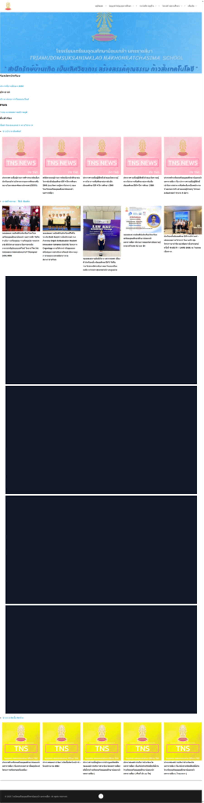
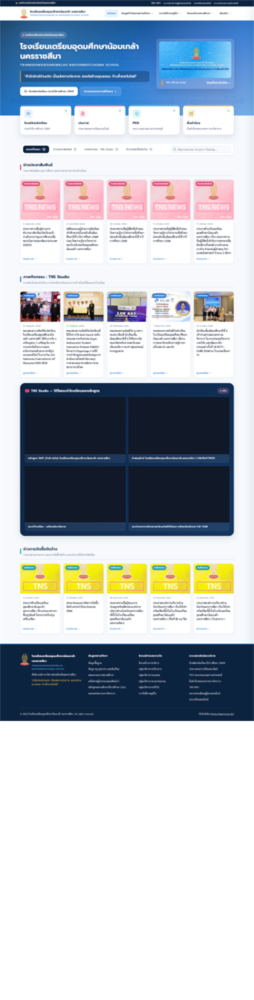

# โรงเรียนเตรียมอุดมศึกษาน้อมเกล้า นครราชสีมา — Landing Page Concept

> **"สำนึกรักษ์บ้านเกิด เป็นเลิศทางวิชาการ สรรค์สร้างคุณธรรม ก้าวล้ำเทคโนโลยี"**  
> **TRIAMUDOMSUKSANOMKLAO NAKHONRATCHASIMA SCHOOL (TNS)** — *องค์การบริหารส่วนจังหวัดนครราชสีมา*

A modern, responsive, accessible landing page redesign concept for **โรงเรียนเตรียมอุดมศึกษาน้อมเกล้า นครราชสีมา**, built to modernize the visual design and user experience while **preserving 100% of the information, links, navigation hierarchy, announcements, media assets, and YouTube embeds** from the official school website ([https://www.tns.ac.th/](https://www.tns.ac.th/)).

---

## Visual Preview (Before & After)

<table width="100%">
  <thead>
    <tr>
      <th width="50%" align="center">Before (<code>https://www.tns.ac.th/</code>)</th>
      <th width="50%" align="center">After (Updated Landing Page Concept)</th>
    </tr>
  </thead>
  <tbody>
    <tr>
      <td width="50%" valign="top" align="center">
        
      </td>
      <td width="50%" valign="top" align="center">
        
      </td>
    </tr>
  </tbody>
</table>

---

## Key Features & Improvements

- **100% Content Fidelity:** Every menu item, nested submenu, e-service portal, announcement, activity photo, procurement notice, YouTube video, school emblem, and copyright notice from `https://www.tns.ac.th/` is preserved with its exact Thai/English text and destination URL.
- **TNS Brand Design System:** Styled around the school's visual identity (`#59b3f1` Sky Blue, `#1976d2` Royal Blue, `#0c2340` Deep Navy, `#f48fb1` Phra Kiao Pink, `#d4af37` Royal Gold, `#00acc1` Cyan) paired with `Prompt` and `Sarabun` typography.
- **Complete 3-Level Navigation:**
  - Desktop sticky glassmorphic header supporting 2-level and 3-level dropdowns (`ข้อมูลทั่วไปของสถานศึกษา` → `เอกสารหลักสูตรสถานศึกษา` → `หลักสูตรสถานศึกษาปีการศึกษา 2563`).
  - Responsive mobile slide-out drawer with expandable accordion menus.
- **4 Quick-Action E-Service Cards:** Elevated portal cards directly below the hero for fast access to admissions, online grades, PSIS behavior scores, and academic document petitions.
- **Interactive Filter Tabs & Live Search:** Filter instantly between **แสดงทั้งหมด (19)**, **ข่าวประชาสัมพันธ์ (5)**, **ภาพกิจกรรม : TNS Studio (9)**, and **ข่าวการจัดซื้อจัดจ้าง (5)**, or search by keyword in real time.
- **Responsive Across Devices:** Scales cleanly from desktop (`1440px`) to tablet and mobile (`390px`) with zero horizontal overflow.

---

## Preserved Content Inventory

### 1. Navigation Menu (`#menu-tns` — 22 Items)
1. **หน้าแรก**
2. **ข้อมูลทั่วไปของสถานศึกษา**
   - ข้อมูลพื้นฐาน
   - ข้อมูล ครู บุคลากร และนักเรียน
   - คณะกรรมการสถานศึกษา
   - เครือข่ายผู้ปกครองและศิษย์เก่า
   - เอกสารหลักสูตรสถานศึกษา → *หลักสูตรสถานศึกษาปีการศึกษา 2563*
   - เอกสารประชาสัมพันธ์
   - เผยแพร่ผลงานทางวิชาการ
3. **รางวัลที่ภาคภูมิใจ**
   - รางวัล สถานศึกษา
   - รางวัล ครูและบุคลากร
   - รางวัล นักเรียน
4. **โครงสร้างสถานศึกษา**
   - โครงสร้างการบริหาร
   - กลุ่มบริหารงานวิชาการ
   - กลุ่มบริหารงานบุคคล
   - กลุ่มบริหารงานงบประมาณ
   - กลุ่มบริหารงานทั่วไป
5. **เพิ่มเติม**
   - TNS WIFI
   - ระบบประเมินครูผู้สอนออนไลน์
   - ระบบเรียนออนไลน์
   - ระบบคะแนนความประพฤติ

### 2. Quick-Action E-Service Portals (4 Cards)
- **รับสมัครนักเรียน** — ประจำปีการศึกษา 2569 (`reg.tns.ac.th`)
- **ประกาศ** — ประกาศผลการเรียนออนไลน์ (`tns.ac.th/grade-report/`)
- **PSIS** — ระบบคะแนนความประพฤติ (`psis.me`)
- **ยื่นคำร้อง** — ยื่นคำร้องขอเอกสารทางวิชาการ (Google Form)

### 3. Announcements & Multimedia (19 Items)
- **ข่าวประชาสัมพันธ์ (5 items):** ODOS scholarship results, M.4 academic entrance score statistics (2569), M.4 exam eligibility announcements (2569 & 2568), and Mathematics assistant teacher recruitment.
- **ภาพกิจกรรม : TNS Studio (5 photo posts + 4 YouTube videos):**
  - 5 student & school achievement highlights (I3O 2026 IoT Olympiad, OASIS Gold Award, Legal Speech Winner, French A2/B1 proficiency, ECTI-CARD 2026).
  - 4 embedded YouTube showcase videos (ISMT Science-Math curriculum, ANURAKTNS13 conservation camp, school introduction, and Digital Arts & Science track 2568).
- **ข่าวการจัดซื้อจัดจ้าง (5 items):** Audio system procurement tender, FY2564 procurement plan, PAO property auction winners, laundry facility lease, and canteen lease announcements.

---

## Project Structure

```text
.
├── index.html      # Semantic HTML5 landing page with all preserved TNS content
├── styles.css      # Brand design tokens, multi-level dropdowns, cards & responsive grids
├── script.js       # Category tabs, live keyword search, mobile drawer & back-to-top
├── preview.png     # After: updated landing page desktop screenshot
├── before.png      # Before: original website screenshot
└── README.md       # Project documentation
```

---

## Running Locally

Because this is a pure static HTML/CSS/JS project with zero build dependencies, you can preview it in seconds:

1. **Direct Browser Open:** Double-click `index.html` to open it in any modern browser.
2. **Local HTTP Server (Recommended):**
   ```bash
   python -m http.server 8123
   ```
   Then visit [http://localhost:8123/](http://localhost:8123/).

---

© 2026 โรงเรียนเตรียมอุดมศึกษาน้อมเกล้า นครราชสีมา. All rights reserved.
